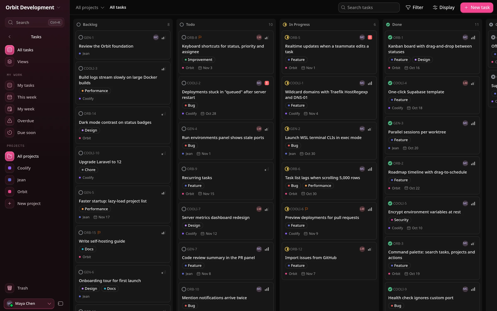
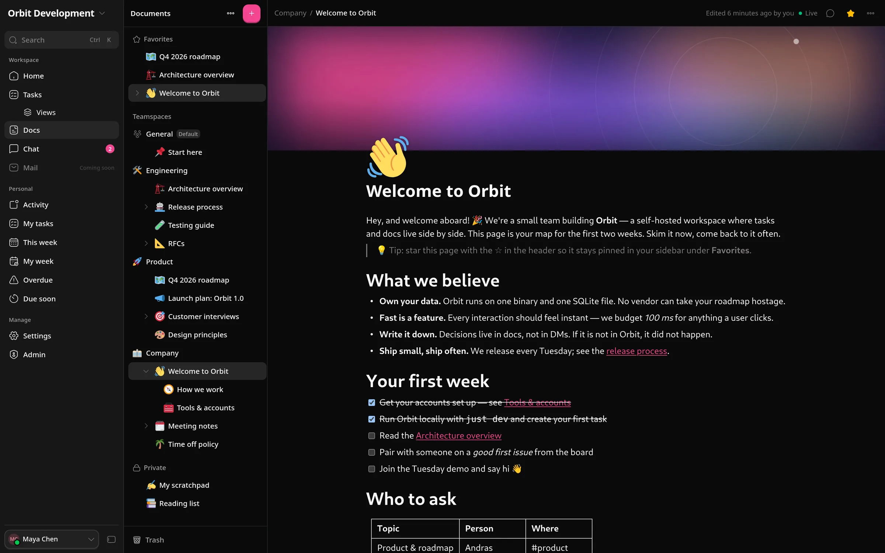
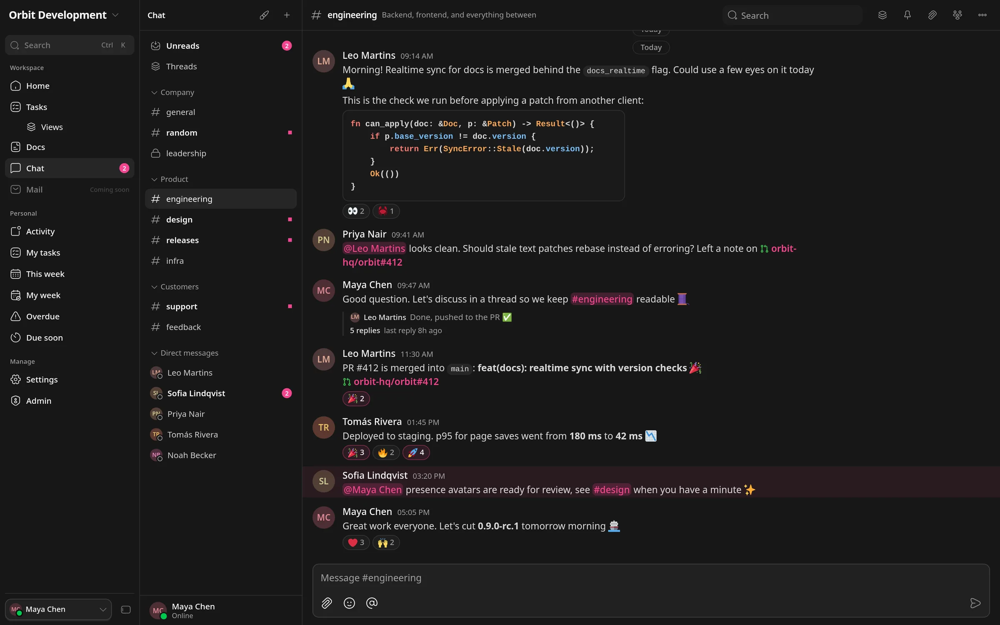
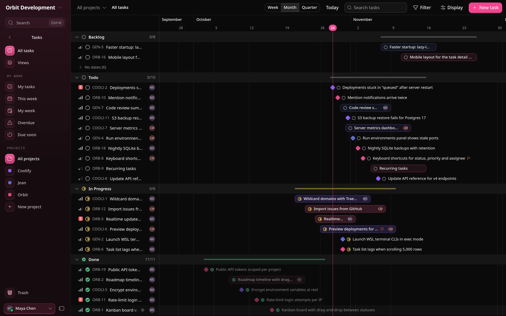
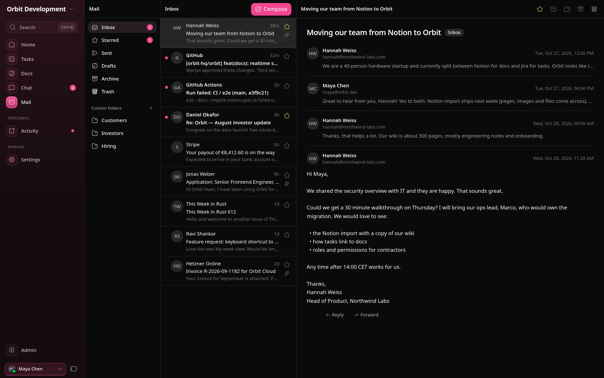
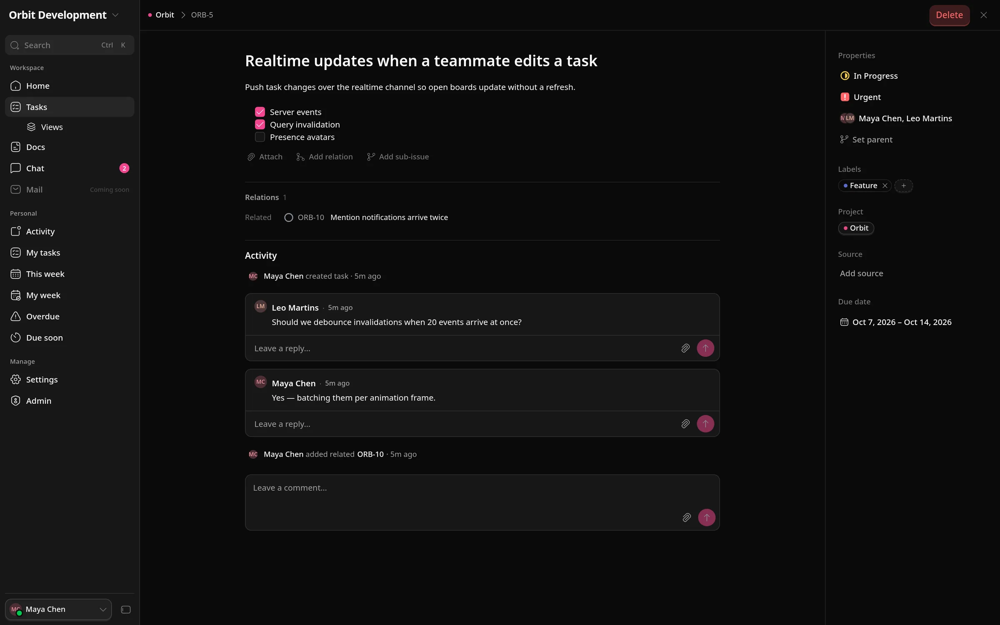
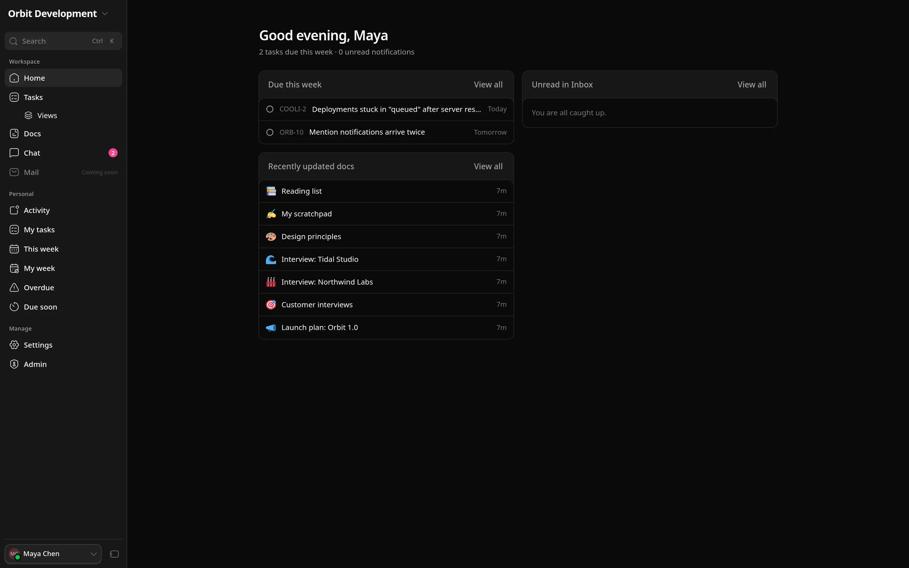

# orbit.so



Landing page for [Orbit](https://github.com/coollabsio/orbit), the self-hosted workspace for teams by coolLabs.

Built with Astro, Tailwind CSS v4 and [Reicon](https://www.npmjs.com/package/reicon) icons, in the same style as coolify.io and coollabs.io, with a pink theme.

<table>
  <tr>
    <td width="50%"><br><sub>Docs</sub></td>
    <td width="50%"><br><sub>Chat</sub></td>
  </tr>
  <tr>
    <td width="50%"><br><sub>Timeline</sub></td>
    <td width="50%"><br><sub>Mail (soon)</sub></td>
  </tr>
  <tr>
    <td width="50%"><br><sub>Task detail</sub></td>
    <td width="50%"><br><sub>Home</sub></td>
  </tr>
</table>

## Development

```bash
bun install
bun run dev      # http://localhost:4321
bun run build    # static site in dist/
```

## Notes

- The app screenshots in `public/images/screenshots/` (also used in this README) were captured from the Orbit web app with demo data (1600x1000 @2x, resized to 2400px WebP).
- `Dockerfile` and `nginx.conf` build and serve the static site.
